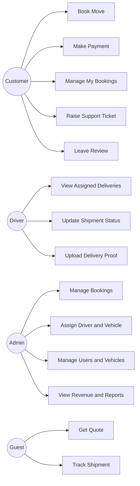
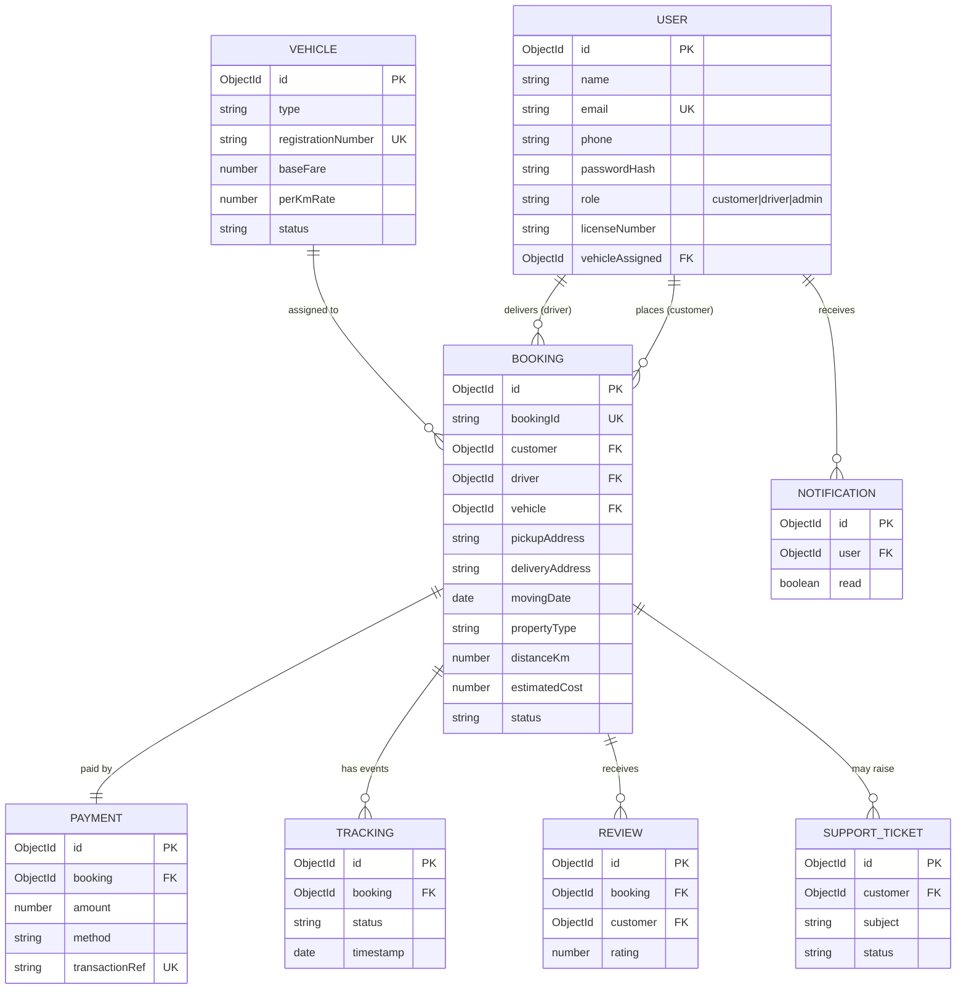
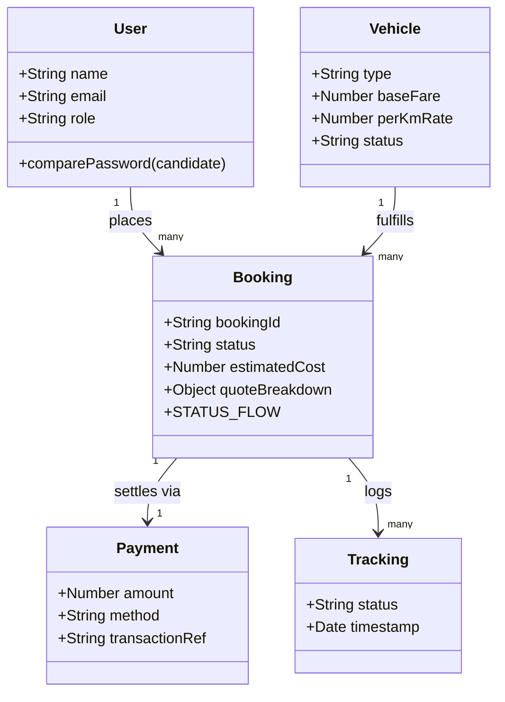
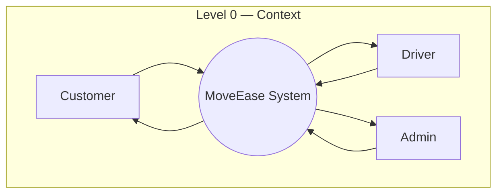
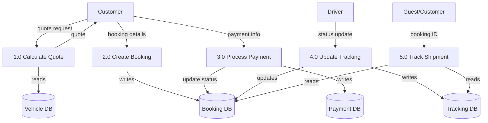
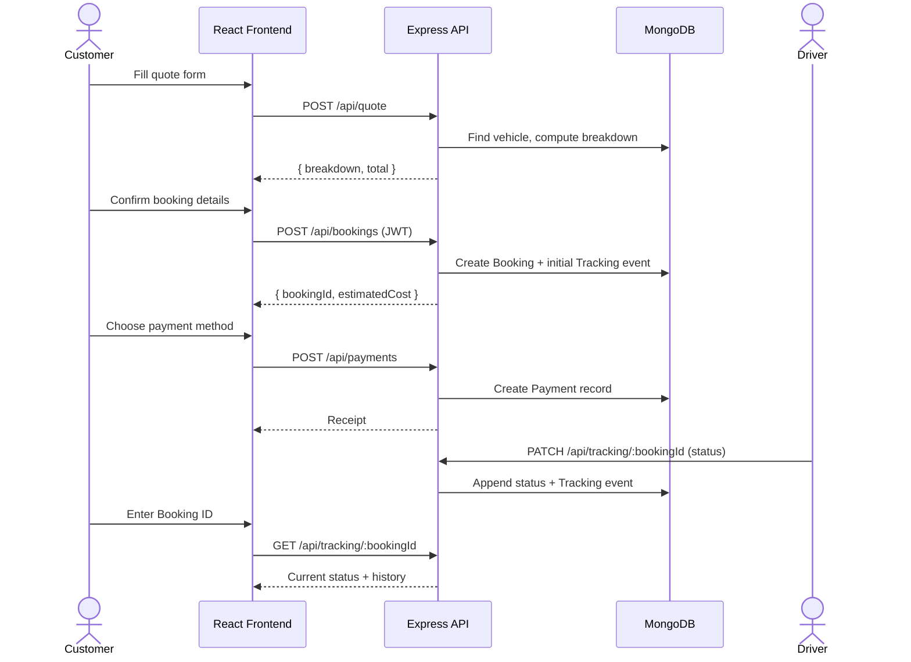
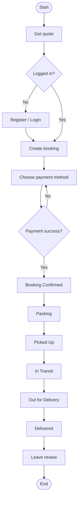
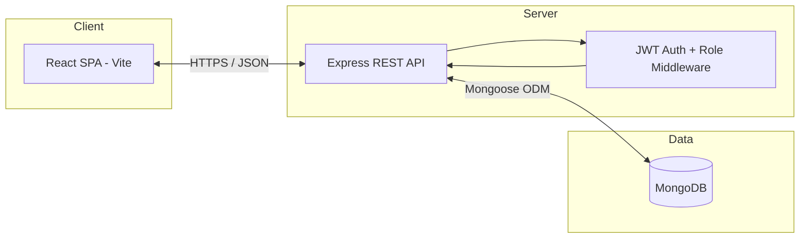

# MoveEase — Software Engineering Documentation

## 1. Requirement Analysis

### 1.1 Functional Requirements
- FR1: A visitor can request an instant quote by entering property type, vehicle, distance, floors, and optional services.
- FR2: A registered customer can convert a quote into a booking with pickup/delivery addresses and a moving date.
- FR3: A customer can pay for a booking via UPI, Card, Net Banking, or Cash, optionally applying a coupon code.
- FR4: The system generates a unique Booking ID on booking creation.
- FR5: Anyone with a Booking ID can view its current status without logging in.
- FR6: A driver can view assigned deliveries, advance shipment status, and upload delivery proof.
- FR7: An admin can view platform-wide statistics, assign drivers/vehicles to bookings, and manage users and vehicles.
- FR8: A customer can raise a support ticket and leave a review after delivery.
- FR9: Authentication is required for booking, payment, and all dashboard actions; roles gate which actions are permitted.

### 1.2 Non-Functional Requirements
- NFR1 (Security): Passwords hashed with bcrypt; JWT-based session; role-based authorization on every protected route; input validation on auth endpoints.
- NFR2 (Usability): Mobile-responsive UI; clear status labels; instant quote feedback.
- NFR3 (Performance): Quote calculation and status lookups resolve in a single indexed query (`bookingId` is unique-indexed).
- NFR4 (Maintainability): Layered structure (routes → controllers → models) with a single source of truth for pricing logic (`utils/calculateQuote.js`).
- NFR5 (Availability): Stateless API behind Express, horizontally scalable; MongoDB replica set recommended for production.

## 2. Use Case Diagram

## 3. Entity-Relationship Diagram

## 4. Class Diagram (backend domain model)

## 5. Data Flow Diagram (Level 0 & 1)

## 6. Sequence Diagram — Quote to Delivery

## 7. Activity Diagram — Booking Lifecycle

## 8. System Architecture

## 9. Database Schema (collections)

| Collection | Key fields | Notes |
|---|---|---|
| users | email (unique), role, passwordHash | role ∈ {customer, driver, admin} |
| vehicles | type, baseFare, perKmRate, status | seeded via `seed/seedVehicles.js` |
| bookings | bookingId (unique), customer, driver, vehicle, status | status enum drives the tracking stepper |
| payments | booking, amount, method, transactionRef (unique) | one payment per booking in this MVP |
| trackings | booking, status, timestamp | append-only audit trail |
| reviews | booking, customer, rating | one review per completed booking (not enforced at schema level) |
| supporttickets | customer, booking, status | admin responds via `reply` field |
| notifications | user, title, read | model present; delivery channel not yet wired |

## 10. Test Cases (sample)

| ID | Scenario | Steps | Expected result |
|---|---|---|---|
| TC01 | Quote calculation | Submit vehicle + distance + services | Breakdown and total returned, matches formula |
| TC02 | Duplicate registration | Register with an email already in use | 400 "Email already registered" |
| TC03 | Booking without auth | POST /api/bookings with no token | 401 "Not authorized, no token" |
| TC04 | Coupon discount | Pay with couponCode=MOVE10 | Amount reduced by 10% of estimatedCost |
| TC05 | Cross-customer access | Customer A requests Customer B's booking by ID | 403 Forbidden |
| TC06 | Driver status update | Driver PATCHes a booking not assigned to them | 403 "Not your assigned booking" |
| TC07 | Tracking lookup | GET /api/tracking/:bookingId with valid ID | 200 with booking, history, statusFlow |
| TC08 | Admin driver assignment | Admin assigns driver+vehicle to a booking | Booking.driver set, Vehicle.status = assigned |

## 11. Risk Analysis

| Risk | Likelihood | Impact | Mitigation |
|---|---|---|---|
| JWT secret leakage | Low | High | Store in environment variables / secrets manager, rotate periodically |
| Double payment on retry | Medium | Medium | Add idempotency key on POST /api/payments before production use |
| Driver over-assignment (double-booked) | Medium | Medium | Add a vehicle-availability check before assignment |
| No rate limiting on auth routes | Medium | Medium | Add `express-rate-limit` on /api/auth/* |
| Delivery proof stored as raw URL | Low | Low | Replace with signed upload (multer + S3/Cloudinary) before production |
| Single payment record per booking | Low | Low | Fine for MVP; extend schema for partial/split payments if needed |
